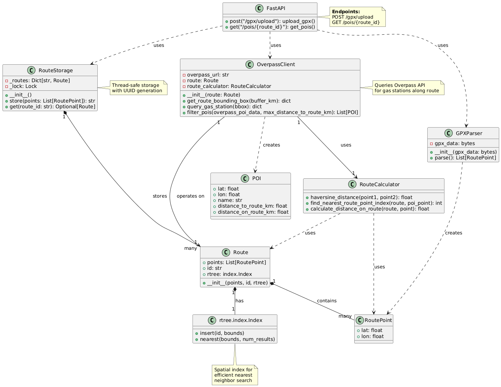

# 🗺️ MapAhead

A web application for finding points of interest (POIs) along GPX routes. Upload your GPX file, visualize your route on an interactive map, and discover gas stations along the way.

## ✨ Features

- 📁 **GPX Upload** - Import GPX files up to 2MB
- 🗺️ **Interactive Map** - Route visualization using Leaflet.js and OpenStreetMap
- ⛽ **POI Discovery** - Automatic gas station detection along your route via Overpass API
- ⚡ **High Performance** - R-tree spatial indexing for sub-second POI filtering
- 📊 **Route Analytics** - Distance calculations and deviation metrics

## 🚀 Quick Start

### Prerequisites

- Python 3.8+
- Modern web browser

### Installation

1. **Clone the repository**
   ```bash
   git clone https://github.com/arcticfade/MapAhead.git
   cd MapAhead
   ```

2. **install or activate venv enviroment**
   - If you haven't use venv before
   ```bash
   sudo apt update && sudo apt install python3-venv
   ```
   - Create environment
   ```bash
   python3 -m venv .venv
   ```
   - Activate it:
     - Linux/IOS
      ```bash
      source .venv/bin/activate      
      ```
      - Windows
     ```bash
      ... .venv\scripts\activate  
      ```
4. **Install dependencies**
   ```bash
   pip install -r requirements.txt
   ```

5. **Start the backend** (in `Backend/` folder)
   ```bash
   cd Backend
   fastapi dev main.py --port 5000   
   ```

6. **Start the frontend** (in `Frontend/` folder)
   ```bash
   cd Frontend
   python -m http.server 4000
   ```

7. **Open in browser**
   ```
   http://localhost:4000
   ```

## 📁 Project Structure

```
MapAhead/
├── Backend/
│   ├── main.py                 # FastAPI application
│   ├── gpx_parser.py           # GPX file parsing
│   ├── route_storage.py        # Route storage with R-tree indexing
│   ├── route_calculator.py     # Distance calculations
│   ├── overpass_client.py      # Overpass API integration
│   └── poi.py                  # POI data model
├── Frontend/
│   ├── index.html              # Main HTML page
│   └── static/
│       ├── script.js           # Frontend logic
│       └── style.css           # Styling
└── tests/
    ├── unit/                   # Unit tests
    └── integration/            # Integration & performance tests
```

## 🏗️ Architecture

### Class Diagram


### Technology Stack

**Backend:**
- FastAPI - REST API framework
- rtree - Spatial indexing (R-tree)
- haversine - Geodesic distance calculations
- gpxpy - GPX parsing

**Frontend:**
- Leaflet.js - Interactive maps
- OpenStreetMap - Map tiles
- Vanilla JavaScript - No framework dependencies

**Testing:**
- pytest - Testing framework
- responses - HTTP mocking
- FastAPI TestClient - API testing

## 🧪 Testing

Run all tests:
```bash
pytest
```

Run specific test suites:
```bash
# Unit tests only
pytest tests/unit/

# Integration tests only
pytest tests/integration/

# Performance tests
pytest tests/integration/test_overpass_client_performance.py
```

## ⚡ Performance Metrics

- **GPX Upload:** < 2 seconds (2MB file)
- **POI Data Retrieval:** < 2 seconds
- **Complete Pipeline:** < 9 seconds
  - BBox Creation: < 1s
  - Overpass Query: < 5s
  - POI Filtering: < 3s

## 🔧 API Endpoints

### `POST /gpx/upload`
Upload a GPX file and receive route data.

**Request:**
- Content-Type: `multipart/form-data`
- File: GPX file (max 2MB)

**Response:**
```json
{
  "route_id": "uuid",
  "filename": "route.gpx",
  "coordinates": [
    {"lat": 52.5200, "lon": 13.4050},
    ...
  ]
}
```

### `GET /pois/{route_id}`
Get POIs (gas stations) along a route.

**Parameters:**
- `route_id` (path): Route UUID
- `max_distance_km` (query, optional): Maximum distance from route (default: 1.0)

**Response:**
```json
{
  "markers": [
    {"lat": 52.5200, "lon": 13.4050, "name": "Shell"}
  ],
  "table": [
    {
      "name": "Shell",
      "distance": "5.2 km",
      "deviation": "120m"
    }
  ]
}
```

## 🤝 Contributing

1. Fork the repository
2. Create a feature branch (`git checkout -b feature/amazing-feature`)
3. Commit your changes (`git commit -m 'Add amazing feature'`)
4. Push to the branch (`git push origin feature/amazing-feature`)
5. Open a Pull Request

## 📝 License

This project is licensed under the MIT License.

## 👨‍💻 Author

[arcticfade](https://github.com/arcticfade)

## 🙏 Acknowledgments

- OpenStreetMap contributors for map data
- Overpass API for POI queries
- Leaflet.js for mapping capabilities
